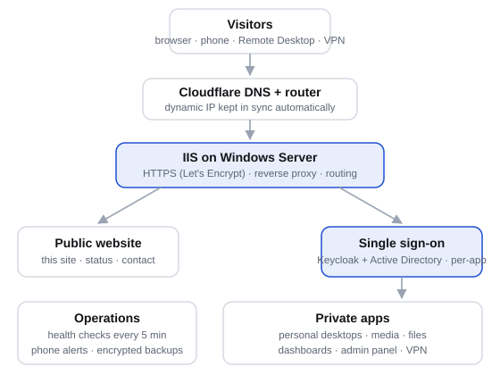

# bairdsystems-platform

The self-hosted platform behind **[bairdsystems.com](https://bairdsystems.com)**: a public website, a single sign-on
portal, personal remote desktops and private apps, all on one Windows Server that I built and run myself.

## What it does

| Area | How |
|---|---|
| **Front door** | IIS with URL Rewrite + Application Request Routing answers every request over HTTPS and routes each subdomain to the right service. Private services listen only on the server or an isolated VM network. |
| **Identity** | Active Directory (Windows Server domain controller on Hyper-V) is the single source of truth. Keycloak federates it over LDAPS and provides the sign-in page; oauth2-proxy guards every private app. One account works for the website, the desktops and the media library. Two-factor for administrators. |
| **Per-app access** | An admin panel (Python/Flask) stores who may open which app and generates the IIS rewrite map that enforces it. Group membership in AD drives desktop and media access. |
| **Personal desktops** | Windows 11 and Ubuntu desktops on Hyper-V, each joined to the domain and visible only to its owner (plus admins). Open in the browser through Apache Guacamole, or in the native Remote Desktop app (multi-monitor) through an RD Gateway that shares port 443 with IIS. |
| **Certificates** | Let's Encrypt wildcard for the web tier and a separate certificate installed on every desktop's RDP listener, both issued with DNS-01 validation through Cloudflare and renewed and redeployed automatically. |
| **Media** | Jellyfin (directory sign-in through its LDAP plugin, restricted to an AD group) and Plex for the home video library on the NAS. |
| **VPN** | WireGuard on the router with one peer per person. A router firewall limits each non-admin peer to their own desktop; configs and QR codes are self-service in the portal. |
| **Operations** | Health checks every five minutes with phone push alerts, a public status page, auto-restart of VMs, a certificate/binding self-heal, and nightly backups encrypted to an RSA public key (the private key never lives on the server), with an off-site copy. |
| **DNS** | Cloudflare, with a small script that follows the home connection's changing IP (see [`scripts/ddns-update.ps1`](scripts/ddns-update.ps1)). |

## Stack

Windows Server · Hyper-V · Active Directory / AD CS · IIS (URL Rewrite, ARR) · Keycloak · oauth2-proxy ·
Apache Guacamole · Remote Desktop Gateway · Docker · PostgreSQL · WireGuard (EdgeRouter) · Cloudflare DNS ·
Let's Encrypt (win-acme) · Jellyfin · Python (Flask, Waitress) · PowerShell

## Things I learned building it

See [LESSONS.md](LESSONS.md): the non-obvious problems (WebSocket compression through ARR, HTTP/2 and browser
desktops, header-based single sign-on, certificate trust on remote desktops) and how each was solved.

## What is not here

Configuration files, credentials, internal addresses and account names are deliberately left out. This repository
describes the design; the running configuration stays on the server.

---
Christopher L. Baird · Peoria, IL · [bairdsystems.com](https://bairdsystems.com) ·
[LinkedIn](https://www.linkedin.com/in/christopher-baird-84a50649/)
